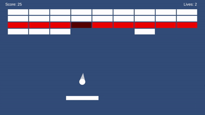

# Breakout · Unity 2D



> 一个从零手写的 Unity 2D 打砖块,3 关。
> **游戏内没有任何美术 / 音频素材文件** —— 图形是引擎内置方块 + 代码逐像素画出的瞄准箭头,
> 音效全部由代码实时合成。

**技术栈**:Unity 2022.3 · C# · 2D 物理 · 零第三方插件 · 17 个脚本 / 约 2000 行

---

## 怎么玩

| 操作 | 按键 |
|---|---|
| 左右移动挡板 | `←` / `→` |
| 调整发射角度 | `↑` / `↓`(不按则随机发射) |
| 发射小球 | `空格` |
| 暂停 / 重新开始 | `P` / `R` |

**用挡板边缘击球,反弹角更刁钻** —— 打砖块的核心技巧就在这里。

---

## 技术亮点

### 1. 事件驱动,并且把单例删干净了

`BrickController` 被打碎时只做一件事:**广播"我碎了"**。
计分、飘分文字、碎屑粒子、摄像机震动、音效 —— 五个互不相干的系统各自订阅。

**可验证的结果**:后来新增"飘分文字"整块功能时,`BrickController` **一行都没有改**。

这条线的重点在**终点**:`CameraShake` 和 `GameController` 原来都是单例,**两个都删掉了**。
判断标准不是"单例是好是坏",而是 ——

> **删掉它之后,还有别的方式能让需要的人拿到这个引用吗?**

删掉 `GameController.Instance` 之后,全项目还在找它的只剩 `DebugCheats` 一个编辑器专用工具。
它改用 `FindObjectOfType`,让 **`GameController` 完全不知道调试工具的存在** ——
工具应该去找被工具,不是反过来。

`GameEvents.cs` · `CameraShake.cs` · `DebugCheats.cs`

### 2. 有对象池,但知道什么时候不该用

同一个"需要很多个"的需求,三种不同的答案:

| 对象 | 方案 | 理由 |
|---|---|---|
| 飘分文字 | **对象池**(`Stack<T>` + 开局预热) | 生命周期短、创建频繁、外形固定 |
| 碎屑粒子 | **一个 `ParticleSystem`** | 能在任意位置发射,比池子更干净:零分配、零管理 |
| 砖块 | **不池化** | 数量可控、一次性生成,加池子只会让代码更复杂 |

> 只写"我用了对象池"是减分项;知道**什么时候不用**,才是判断力。

`ScorePopupSpawner.cs` · `BrickBurstEffect.cs`

### 3. 零素材:音效和图形都是代码生成的

| | 做法 |
|---|---|
| **音效** | 代码合成 `AudioClip` —— 正弦 / 方波 / 白噪声 + 指数包络 + **一阶低通滤波** |
| **瞄准箭头** | 代码逐像素绘制 `Texture2D`,轴心设在底部以便绕球旋转 |
| **关卡** | `ScriptableObject` + 字符串图案掩码,运行时可生成 / 清空砖墙 |

**为什么噪声要滤波**:纯白噪声听起来是廉价的"嘶——"。真实的撞击声被材质吸收过,
高频先被吃掉 —— 一个一阶低通就能把"电子噪声"变成"木头碎裂"。

> 这条有边界。同一套办法**没做出**令人满意的砖块裂纹 —— 见下一节最后一条。

`SfxLibrary.cs` · `SpriteFactory.cs` · `LevelData.cs`

---

## 工程习惯

**配置故障必须吼,而且吼完要止损。**
项目里所有 `null` 守卫遵循同一个约定:挡住「别人的事」(业务条件)可以静默;
挡住「我的事」(配置故障)**必须在 Console 大声报错**,然后 `enabled = false`。
只吼不止损,下一次调用会再抛一次,日志刷屏,真正的原因反而被埋掉。

**注释记录的是"为什么不这么写"。**
代码里大量 `⚠️` 标记,写的不是"这行干什么",而是**"这行为什么必须这么写、不这么写会怎样"**。
每条都来自一次实际跑出来的结果,而不是"看起来应该这样"。
比如:`Vector3` 之间没有逐分量相乘的 `*`;粒子系统的模块结构体改副本**会**生效、
而 `Vector3` 改副本**不会**;`?.` 会绕过 Unity 重载的 `==`,拿不到"已销毁对象"的假 null。

**砍掉做过的东西。**
砖块受伤原本是"整体压暗",但**颜色深 = 更硬**是更通用的直觉,玩家会读反。
于是花了一轮做程序化裂纹贴图(随机游走 + 逐像素光栅化 + 按档位缓存),
做完四组目测实验,判定**得不偿失,整条方案回滚**。

理由是:程序化生成能表达**「规则」**,不能表达**「品味」** ——
音效和箭头能成功,是因为"叮"就是频率 + 包络、"箭头"就是一个几何定义,**参数即全部**;
而"看起来像裂开的砖"是几百次视觉决策的沉淀,不在公式里。

> **"已经投入了所以不能白费"是最贵的陷阱。**

---

## 运行

用 **Unity 2022.3** 打开本目录,运行 `Assets/Scenes/SampleScene.unity`。
构建:文件 → 生成设置 → 目标平台 Windows x64 → 生成。

> **关于构建体积**:Unity 桌面构建有固定的体重下限 —— `UnityPlayer.dll` 30MB +
> .NET 类库 27MB + Mono 运行时 9MB,和游戏内容无关。本项目自身的内容只占约 3.5MB。

---

## 项目结构

```
Assets/
├── Scripts/     17 个 C# 文件,约 2000 行
├── Levels/      3 个关卡的 ScriptableObject
├── Prefabs/     Brick.prefab / ScorePopup.prefab
├── Physics/     Bouncy.physicsMaterial2D(弹性 = 1,摩擦 = 0)
└── Scenes/      SampleScene.unity
```

核心几个:[`GameController`](Assets/Scripts/GameController.cs)(状态与流程)·
[`GameEvents`](Assets/Scripts/GameEvents.cs)(静态事件中心)·
`BrickController` / `BallController` / `PaddleController`(三个游戏对象)·
`SfxLibrary` / `SpriteFactory`(程序化素材)·
`LevelData` / `BrickSpawner`(关卡数据与生成)。

完整列表见 [`Assets/Scripts/`](Assets/Scripts/)。

---

## 已知限制

- **没有存档**,退出即丢失进度
- **没有设置菜单**,音量和难度不可调
- 只有 **3 关**
- 球偶尔会卡在挡板和墙壁之间(2D 物理的经典边界情况)
